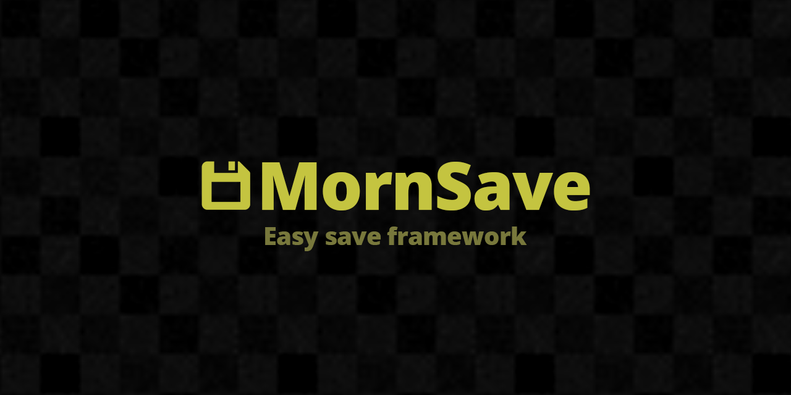

# MornSave

<p align="center">
  
</p>

<p align="center">
  
</p>

## 概要

Unity 向けの簡単に使えるセーブデータフレームワーク。PlayerPrefs / ファイル保存、AES 暗号化、Steam ユーザーごとのセーブ分離に対応。

## 導入方法

Unity Package Manager で以下の Git URL を追加:

```
https://github.com/TsukumiStudio/MornSave.git?path=src#1.0.0
```

`Window > Package Manager > + > Add package from git URL...` に貼り付けてください。

### 依存パッケージ

- [MornGlobal](https://github.com/TsukumiStudio/MornGlobal) (`com.tsukumistudio.mornglobal`)
- [MornUtil](https://github.com/TsukumiStudio/MornUtil) (`com.tsukumistudio.mornutil`)
- [MornDebug](https://github.com/TsukumiStudio/MornDebug) (`com.tsukumistudio.morndebug`)
- [MornSteam](https://github.com/TsukumiStudio/MornSteam) (`com.tsukumistudio.mornsteam`)

## ライセンス

[The Unlicense](LICENSE)
